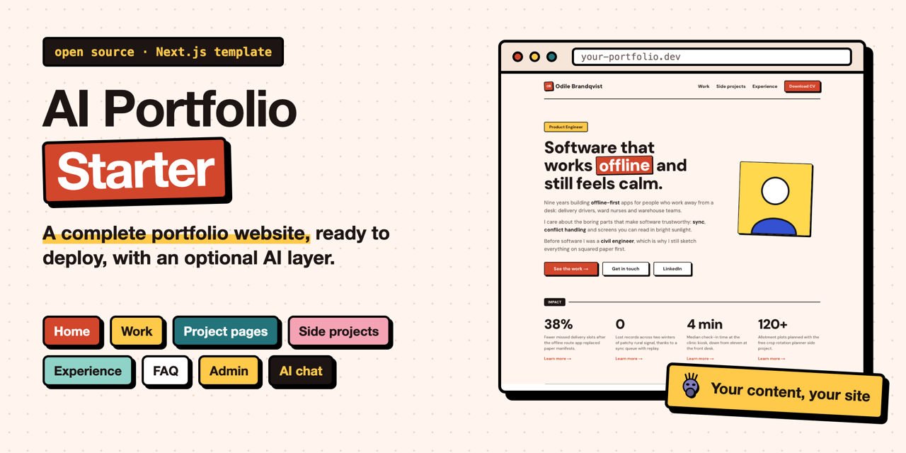
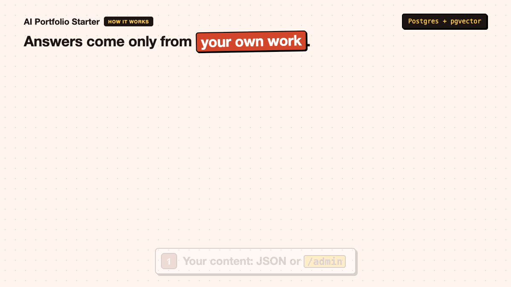
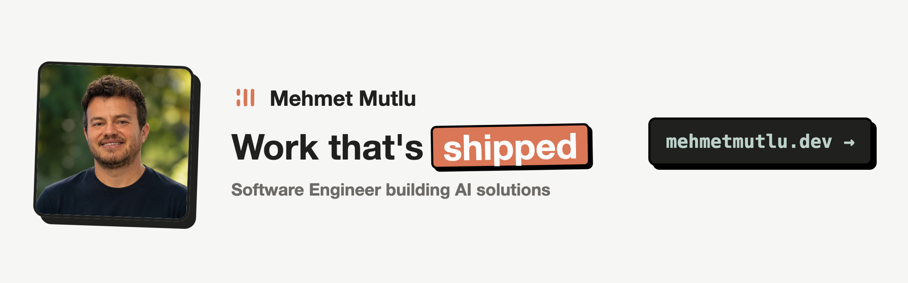

# AI Portfolio Starter



**An open source portfolio site for developers and designers, with an AI assistant that answers questions about your work, a job-fit check for recruiters, and an MCP server, all grounded in your own content.**

Built with Next.js 16, Prisma 7, Postgres with pgvector and OpenAI. Deploys to Vercel with a free Neon database. Ships with a fictional sample persona (Odile Brandqvist, a product engineer) so you can see everything working before you add your own content.

## Features

| Feature | What it does | Default |
|---|---|---|
| Portfolio pages | Home, work, side projects, project pages built from content blocks (text, images, code, video, embeds), experience timeline, FAQ | Always on |
| AI chat (RAG) | Visitors ask questions; answers come only from your projects, experience and FAQs (retrieval augmented generation over pgvector) | On |
| Job-fit check | Recruiters paste a job description (or upload PDF, .docx or .txt) and get a verdict, strengths and gaps | On |
| MCP server | `/api/mcp` exposes the chat, the fit check and your CV link to any MCP client | On |
| Admin panel | Password protected `/admin` to edit projects, tags, FAQs and experience; the search index updates itself | On |
| CV download | `/cv` serves `public/cv.pdf` with a dated file name | On |
| Rate limiting | Per-IP limits on every AI endpoint | On |
| Canned answers | Fixed replies for chosen questions, checked before the AI is called | Off |

## How it works



1. Your content (projects, experience, FAQs) lives in Postgres. You load it from the JSON files in `content/` or edit it in `/admin`.
2. `npm run rag:ingest` splits that content into short chunks, turns each into an embedding (a list of 1536 numbers that captures its meaning) with OpenAI, and stores them in a pgvector column.
3. When a visitor asks a question, the question is embedded the same way, the closest chunks are found by cosine distance, and only those chunks are given to the chat model as context.
4. The fit check does the same with a job description, and the model's JSON answer is validated before it is shown.
5. The MCP server wraps the same two functions as tools, so an AI assistant can query your portfolio directly.

Admin edits and the content scripts re-sync the index automatically. Only changed text is embedded again, so edits cost almost nothing.

## Deploy in one click

[](https://vercel.com/new/clone?repository-url=https%3A%2F%2Fgithub.com%2Fmutlumehmet%2Fai-portfolio-starter&project-name=my-portfolio&repository-name=my-portfolio&env=OPENAI_API_KEY%2CADMIN_PASSWORD%2CSESSION_SECRET&envDescription=An%20OpenAI%20API%20key%20for%20the%20chat%2C%20a%20password%20for%20%2Fadmin%2C%20and%20any%20long%20random%20string%20to%20sign%20the%20admin%20session.&envLink=https%3A%2F%2Fgithub.com%2Fmutlumehmet%2Fai-portfolio-starter%23environment-variables&stores=%5B%7B%22type%22%3A%22integration%22%2C%22protocol%22%3A%22storage%22%2C%22integrationSlug%22%3A%22neon%22%2C%22productSlug%22%3A%22neon%22%7D%5D)

The button copies this repo to your GitHub account, creates a free Neon database for it, and asks for three values: your OpenAI API key, a password for `/admin`, and a long random string for `SESSION_SECRET` (`openssl rand -base64 32`). The first deploy then sets the database up by itself: it creates the tables, loads the sample content and builds the chat's search index (see [What happens on deploy](#what-happens-on-deploy)). You get a working site with the sample persona; then [make it yours](#make-it-yours) and follow the [cost steps](#cost-and-security) before you share the link.

## Quick start

You need Node.js 20 or newer and an OpenAI API key. Pick Neon (hosted) or Docker (local) for the database.

```bash
# Use "Use this template" on GitHub, or clone your fork:
git clone https://github.com/<your-username>/ai-portfolio-starter.git
cd ai-portfolio-starter
npm install
cp .env.example .env
```

### Option A: Neon (recommended, works with Vercel)

1. Create a free project at [neon.tech](https://neon.tech).
2. Copy its connection string into `DATABASE_URL` in `.env`. You do not need to enable anything by hand: the first migration creates the `vector` extension.

### Option B: Docker for local development

```bash
npm run db:up   # Postgres 17 with pgvector on localhost:5432
```

The default `DATABASE_URL` in `.env.example` already points at it. `npm run db:down` stops it.

### Then, for either option

1. Set `ADMIN_PASSWORD`, `SESSION_SECRET` (`openssl rand -base64 32`) and `OPENAI_API_KEY` in `.env`.
2. Create the tables, load the sample content and build the search index:

```bash
npm run db:migrate   # prisma migrate deploy
npm run db:seed      # loads content/ into the database
npm run rag:ingest   # embeds the content for the chat
npm run dev
```

Open http://localhost:3000.

### Deploy to Vercel by hand

1. Push your copy to GitHub and import it in Vercel.
2. Add the environment variables from `.env` (at least `DATABASE_URL`, `ADMIN_PASSWORD`, `SESSION_SECRET` and `OPENAI_API_KEY`). `NEXT_PUBLIC_SITE_URL` is only needed for a custom domain; otherwise the Vercel production URL is used.
3. Deploy. The first build prepares the database, as below.
4. Before you share the link, follow the cost steps in [Cost and security](#cost-and-security).

### What happens on deploy

Vercel runs `npm run vercel-build` (`scripts/vercel-build.ts`), which runs these steps before the normal build:

1. `prisma migrate deploy`: creates or updates the tables and the `vector` extension. It uses `DATABASE_URL_UNPOOLED` when set (the Neon integration sets it), because migrations need a direct connection.
2. Loads the sample content from `content/`, **only while the database has no projects**, so it never overwrites or brings back what you changed in `/admin`.
3. `rag:ingest`: embeds only new or changed text, so a redeploy with no content changes costs nothing. If `OPENAI_API_KEY` is missing or wrong, the build still succeeds and prints a warning; fix the key and redeploy.

Without `DATABASE_URL` the steps are skipped and only the site is built. `npm run build` never touches the database, so local builds work offline. If you use Vercel preview deployments with the same database as production, previews run the same migrations against it; Neon's integration can give each preview its own database branch instead.

## Environment variables

| Variable | Required | Purpose |
|---|---|---|
| `DATABASE_URL` | Yes | Postgres with pgvector. Neon URLs use Neon's serverless driver, others use node-postgres. `DATABASE_DRIVER=neon` or `pg` forces one. |
| `ADMIN_PASSWORD` | For admin | Password for `/admin`. Refused in production while it is still the example value. |
| `SESSION_SECRET` | For admin | Signs the admin cookie. Changing it logs every session out. |
| `OPENAI_API_KEY` | For AI features | Embeddings and answers. |
| `CHAT_MODEL` | No | Defaults to `gpt-4.1-mini`. |
| `EMBEDDING_MODEL` | No | Defaults to `text-embedding-3-small` (1536 dimensions). |
| `NEXT_PUBLIC_SITE_URL` | No | Public URL; overrides `url` in `site.config.ts`. |
| `FEATURE_*` | No | Feature flag overrides, see below. |
| `RATE_LIMIT_PER_MINUTE`, `RATE_LIMIT_PER_DAY` | No | Per-IP limits for the AI endpoints. |

**About the embedding dimension:** the `Chunk.embedding` column is `vector(1536)`, the output size of `text-embedding-3-small`. If you switch to a model with a different size, change `vector(1536)` in `prisma/schema.prisma`, create a new migration, and run `npm run rag:ingest -- --full`.

## Make it yours

1. **`site.config.ts`** holds everything person-specific: name, initials, role, contact, socials, hero text, stats, journey, colours, chat persona and suggestions, fit-check criteria, MCP server name, CV file name, admin label, SEO and feature flags. Start here.
2. **`content/`** holds the sample content. Replace `content/projects/*.json` (same shape as `scripts/example-project.json`), `content/experience.json` and `content/faqs.json`, then run `npm run db:seed` and `npm run rag:ingest`. The seed upserts by slug, so remove the sample projects in `/admin` or with `npm run project:delete -- <slug>`.
3. **Images** go in `public/`. Project images live in `public/projects/<slug>/`; their sizes are measured at install and build time so covers of the right shape fill their card. Replace `public/avatar.svg` with your photo (and update `person.photo`).
4. **CV:** replace `public/cv.pdf` with your own.
5. **`/admin`** lets you edit all content in the browser once deployed. Every save updates the chat's search index in the background.
6. **Single projects from the command line:** `npm run project:upsert -- path/to/project.json`.

## Feature flags

Set in `site.config.ts` under `features`, or per deployment with environment variables (`true`/`false`), which win.

| Flag | Env var | Default | When off |
|---|---|---|---|
| `chat` | `FEATURE_CHAT` | on | Chat tab hidden, `/api/chat` returns 404, MCP chat tool removed |
| `fitCheck` | `FEATURE_FIT_CHECK` | on | Fit-check tab hidden, `/api/fit-check` returns 404, MCP tool removed |
| `parseJd` | `FEATURE_PARSE_JD` | on | File upload hidden, `/api/parse-jd` returns 404 (also off when `fitCheck` is off) |
| `mcp` | `FEATURE_MCP` | on | MCP tab hidden, `/api/mcp` returns 404 |
| `admin` | `FEATURE_ADMIN` | on | `/admin` returns 404 and every admin action refuses to run |
| `cv` | `FEATURE_CV` | on | CV buttons hidden, `/cv` returns 404 |
| `easterEggs` | `FEATURE_EASTER_EGGS` | off | Canned answers in `easterEggs` are ignored |
| `rateLimit` | `FEATURE_RATE_LIMIT` | on | No per-IP limits (not recommended in production) |

## Cost and security

The AI endpoints are public, so anyone can make the site spend your OpenAI credit. Each chat or fit-check call is one embedding plus one chat completion with roughly 1,500 to 3,000 input tokens: a fraction of a cent at current prices, so the risk is volume, not single calls. Before you share the link:

1. **Set a monthly budget** on the OpenAI project that owns your key (OpenAI dashboard, project limits). This is the hard stop.
2. **Add a Vercel Firewall rate limit rule** for `/api/*` (Vercel dashboard, Firewall). The built-in limiter works per server instance, so it slows a single client down but is not a global cap.
3. Use a long random `ADMIN_PASSWORD` and `SESSION_SECRET`.

What the code already does: every admin server action checks the session itself (not only the `/admin` proxy); login attempts are rate limited and only redirect inside `/admin`; AI inputs have length caps (2,000 characters for questions, 8,000 for job descriptions, 5 MB for uploads); the prompts treat visitor text as data and refuse off-topic requests; the fit-check JSON is validated with zod; embeds run in a sandboxed iframe with an optional host allowlist (`embeds.allowedHosts`). Sessions last 7 days and cannot be revoked one by one; rotate `SESSION_SECRET` to log everyone out.

The fit check is a guide, not proof: it only knows what is on your site, and the page says so.

See [SECURITY.md](SECURITY.md) to report a vulnerability.

## MCP usage

With `mcp` on, your deployed site is a remote MCP server (Streamable HTTP) at `https://your-domain/api/mcp` with these tools:

| Tool | Input |
|---|---|
| `ask_about_<firstName>` | `question` (up to 2,000 characters) |
| `check_job_fit` | `jobDescription` (20 to 8,000 characters) |
| `get_cv` | none, returns the `/cv` link |

Connect it from Claude Code:

```bash
claude mcp add --transport http your-portfolio https://your-domain/api/mcp
```

Other MCP clients that support remote HTTP servers take the same URL. MCP calls share the per-IP rate limits of the site.

## Project structure

```
site.config.ts        everything person-specific, plus feature flags
content/              sample projects, experience and FAQs (JSON)
prisma/               schema, single init migration, seed (loads content/)
scripts/              ingest, project upsert and delete, cover measuring
src/app/              pages, admin, API routes (chat, fit-check, parse-jd, mcp), /cv
src/components/       UI, including shadcn/ui primitives in ui/
src/lib/              config, RAG, index sync, auth, rate limiting, content blocks
public/               avatar, sample CV, project images, embed video player
docker-compose.yml    local Postgres with pgvector
```

## Tips

* Prisma publishes agent skills for working with Prisma; install them with your agent's skills tooling if you use an AI coding assistant.
* `npm run rag:ingest -- --full` re-embeds everything (after a model change).
* Content written by scripts appears immediately, because content pages render on request.

## Credits

* [shadcn/ui](https://ui.shadcn.com) for the UI primitives in `src/components/ui/` (MIT).
* [neobrutalism.dev](https://www.neobrutalism.dev) ([neobrutalism-components](https://github.com/ekmas/neobrutalism-components), MIT, by Samuel Breznjak) for the neo-brutalist border, shadow and radius structure.
* [Simple Icons](https://simpleicons.org) for the GitHub mark (CC0).
* DM Sans and Geist Mono fonts (SIL Open Font License), via `next/font`.
* Built on Next.js, React, Prisma, pgvector, Tailwind CSS, OpenAI, mcp-handler, unpdf and mammoth.

## Licence

Code: [MIT](LICENSE). Sample content (everything in `content/`, the sample CV, avatar and project images in `public/`) is released under [CC0](https://creativecommons.org/publicdomain/zero/1.0/): use it freely while you test. The sample persona and every company and project in it are fictional; any resemblance to real people or businesses is a coincidence.

## About

[](https://www.mehmetmutlu.dev)

Made by Mehmet Mutlu, [mehmetmutlu.dev](https://www.mehmetmutlu.dev). If it helps you, you can support it on [GitHub Sponsors](https://github.com/sponsors/mutlumehmet) or [Buy Me a Coffee](https://buymeacoffee.com/mutlumehmet).
