# AI Portfolio Starter


**A complete portfolio website for developers and designers, plus an optional AI layer that answers questions about your work from your own content.**

<p align="center"><a href="https://www.mehmetmutlu.dev">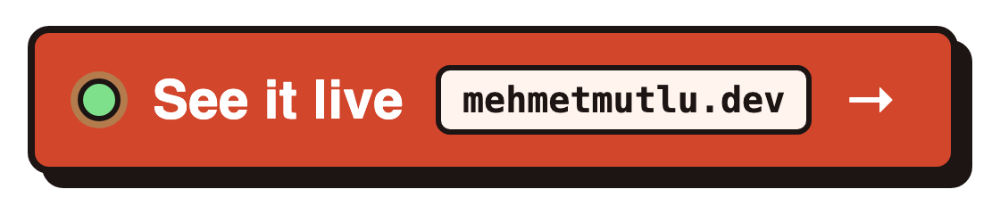</a></p>

*See it live* opens the portfolio this template was extracted from: same structure, AI chat and job-fit check, with its own content and colours.

## Three ways to set it up

All three can start from your LinkedIn profile, CV and GitHub: the draft is made by your own OpenAI key or your own coding agent, and you review it before anything is written (see [Import from LinkedIn, CV and GitHub](#import-from-linkedin-cv-and-github)).

**1. Deploy with Vercel, no code**

[](https://vercel.com/new/clone?repository-url=https%3A%2F%2Fgithub.com%2Fmutlumehmet%2Fai-portfolio-starter&project-name=my-portfolio&repository-name=my-portfolio&env=OPENAI_API_KEY%2CADMIN_PASSWORD%2CSESSION_SECRET&envDescription=An%20OpenAI%20API%20key%20for%20the%20chat%2C%20a%20password%20for%20%2Fadmin%2C%20and%20any%20long%20random%20string%20to%20sign%20the%20admin%20session.&envLink=https%3A%2F%2Fgithub.com%2Fmutlumehmet%2Fai-portfolio-starter%23environment-variables&stores=%5B%7B%22type%22%3A%22integration%22%2C%22protocol%22%3A%22storage%22%2C%22integrationSlug%22%3A%22neon%22%2C%22productSlug%22%3A%22neon%22%7D%5D)

Copies the repo to your GitHub, creates a free Neon database, asks for three values and deploys; the first build sets up the tables, sample content and search index. Then open `/admin/import` on your new site to draft your content from LinkedIn, a CV and GitHub. Details in [Deploy in one click](#deploy-in-one-click).

**2. One command on your machine**

```bash
git clone https://github.com/mutlumehmet/ai-portfolio-starter.git my-portfolio
cd my-portfolio && npm install && npm run setup
```

Offers to import from your LinkedIn, CV and GitHub first, then asks for your name, links, colour theme, database and OpenAI key, writes your config and `.env`, sets up the database and starts the site at http://localhost:3000.

**3. Ask your coding agent**

Open the cloned folder in Claude Code, Codex or another coding agent and paste:

```text
Set up this AI Portfolio Starter for me. Read README.md and AGENTS.md first, then follow
"Setting the site up for a new owner" in AGENTS.md. Start by asking me for my LinkedIn URL,
CV file and GitHub username, draft my content from them without inventing anything, and
show me the summary before you write. Then ask me what is missing a few questions at a
time, fill everything in, load it, and start the site so I can check it.
```

The agent reads your LinkedIn, CV and GitHub, shows you a draft, asks for anything missing, fills in the config, replaces the sample content with yours and loads it with the project scripts.

## Take the tour

Every page of the site, shown with the sample content: home, selected work, project pages, side projects, experience, FAQ, the admin panel and the AI layer.

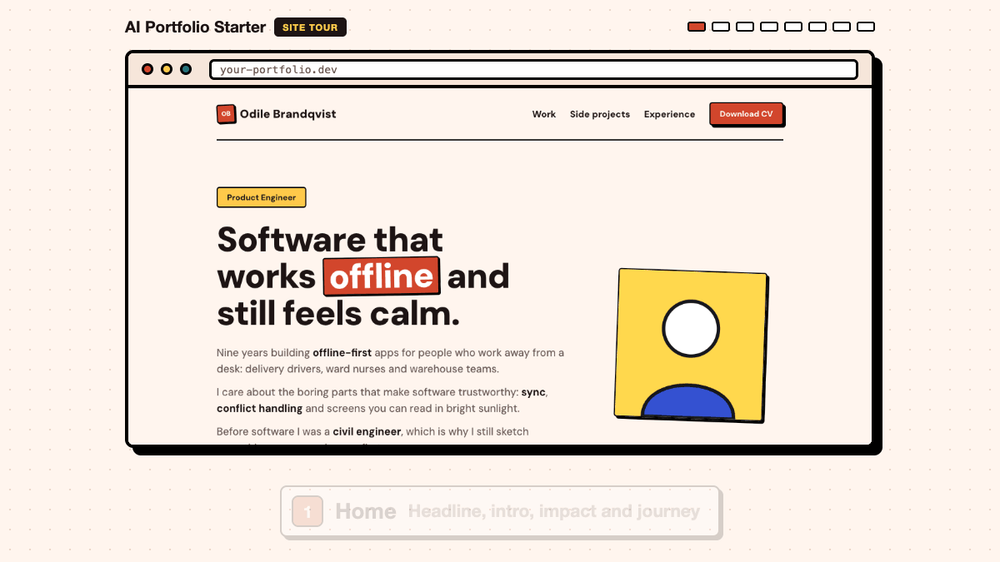

## How the AI layer answers

The chat, the fit check and the MCP server answer only from your own content, through the same search. Details in [The AI layer](#the-ai-layer-optional).


## Manage it with your agent

Edit content in `/admin`, or let any coding agent add and remove projects with a JSON file. The search index re-syncs after every write. See [Make it yours](#make-it-yours).

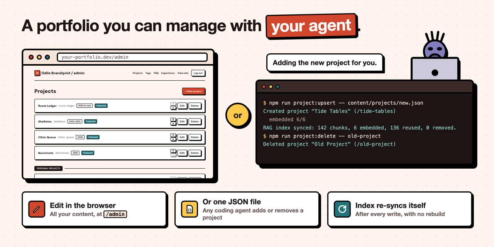

## Looks right on every screen

Every page has a phone, tablet and desktop layout, with a menu on phones, and the admin panel works on a phone too.

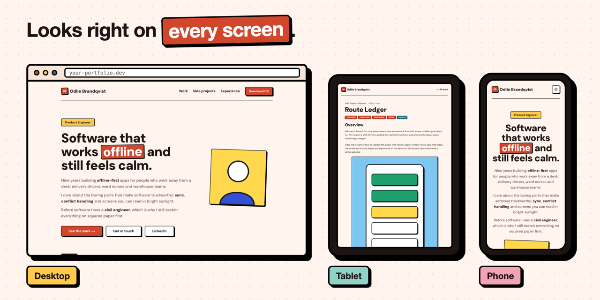

## Everything is ready

The parts you would otherwise build yourself are already in place. Details in [Ready to deploy](#ready-to-deploy).

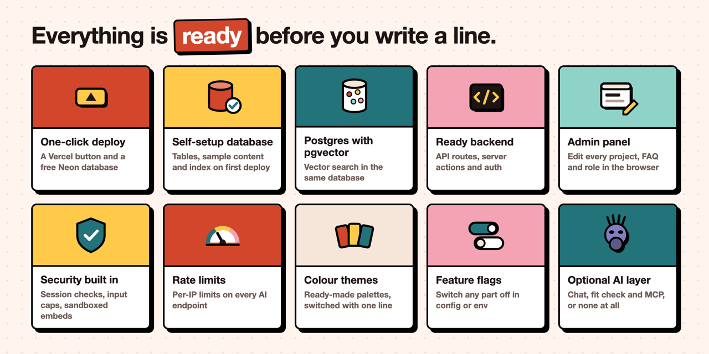

## Ready to deploy

Built with Next.js 16, Prisma 7, Postgres with pgvector and OpenAI. Deploys to Vercel with a free Neon database. Ships with a fictional sample persona (Odile Brandqvist, a product engineer) so you can see every page working before you add your own content.

Everything below is already done for you.

| Built in | What you get |
|---|---|
| **One-click deploy** | The Vercel button copies the repo and creates a free Neon database for you. |
| **Self-setup database** | The first deploy runs the migrations, loads the sample content and builds the search index. |
| **Postgres with pgvector** | The first migration creates the `vector` extension, so there is nothing to enable by hand. |
| **Admin panel** | Edit projects, tags, FAQs and experience in the browser at `/admin`. |
| **Responsive** | Phone, tablet and desktop layouts for every page, a mobile menu, and an admin panel that works on a phone. |
| **Security** | Every admin action checks the session, login attempts are limited, and AI inputs have length caps. |
| **Rate limits** | Per-IP limits on every AI endpoint. |
| **SEO and share images** | Page titles and descriptions, Open Graph tags, a generated share image for the site, and each project's cover as its share image. |
| **Colour themes** | Ready-made [colour themes](#colour-themes), including pastels and neutrals, switched with one line. |
| **Feature flags** | Switch any part off in `site.config.ts` or with an environment variable. |
| **Optional AI layer** | Switch the chat, the fit check and the MCP server off and you have a plain portfolio. |

## What's inside

The portfolio is a full site on its own. These are its pages, shown with the sample content.

<table>
<tr>
<td valign="top" width="50%">
<a href="src/app/page.tsx">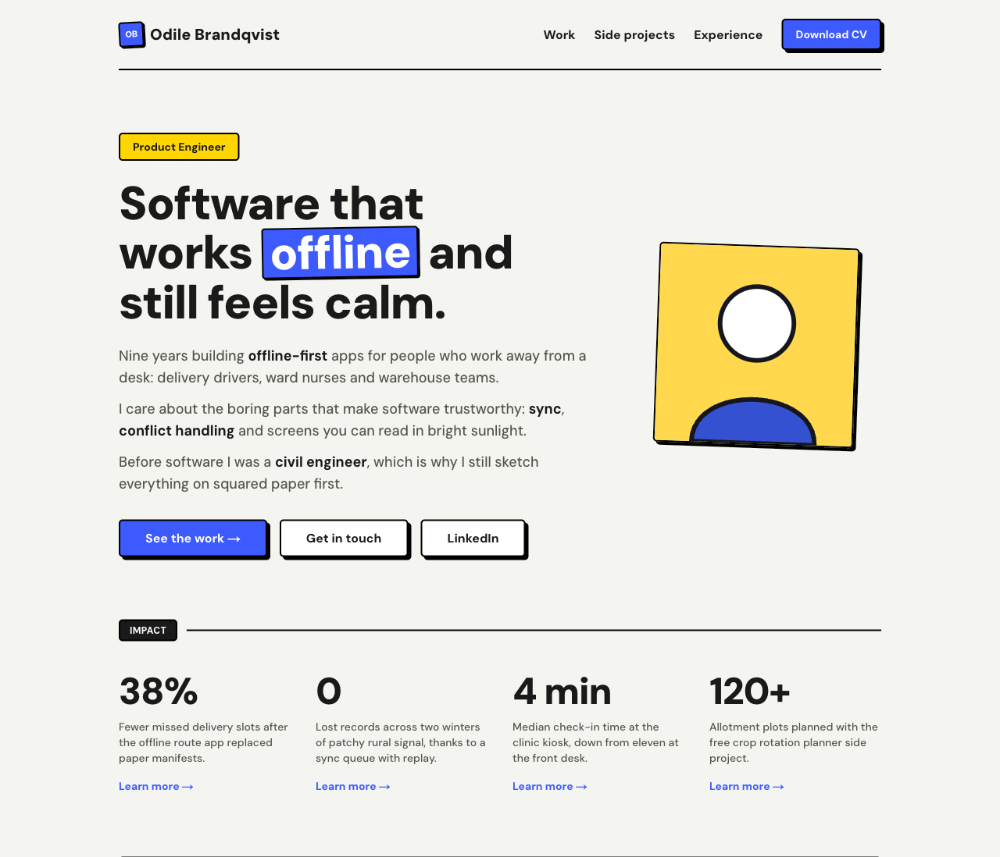</a><br>
<b>Home</b>: your headline, intro, photo, impact numbers and career journey, then featured work, side projects and the FAQ. The text comes from <code>site.config.ts</code>; the projects and FAQs come from the database.
</td>
<td valign="top" width="50%">
<a href="src/app/projects/page.tsx">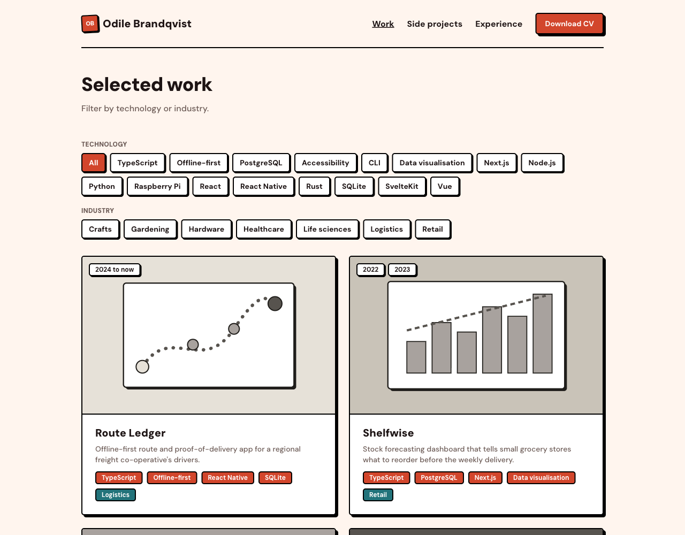</a><br>
<b>Selected work</b> (<code>/projects</code>): every project as a card with its cover and tags, paid work first. Visitors filter by technology or industry.
</td>
</tr>
<tr>
<td valign="top" width="50%">
<a href="src/app/projects/%5Bslug%5D/page.tsx">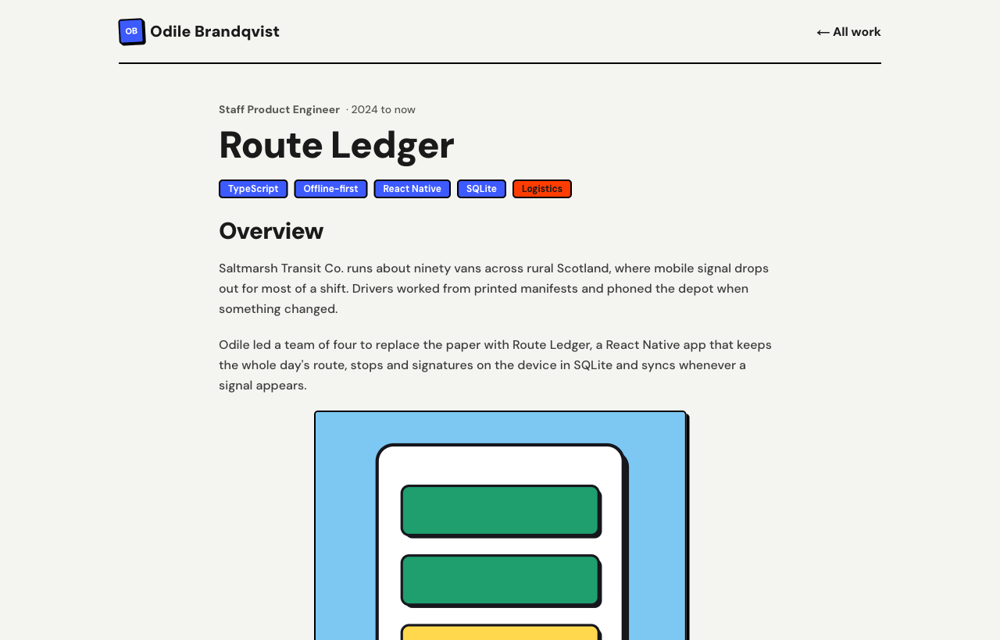</a><br>
<b>Project page</b> (<code>/projects/&lt;slug&gt;</code>): a case study built from content blocks (text, images, code, video and embeds). Each project is one JSON file in <code>content/projects/</code> or one entry in <code>/admin</code>.
</td>
<td valign="top" width="50%">
<a href="src/app/side-projects/page.tsx">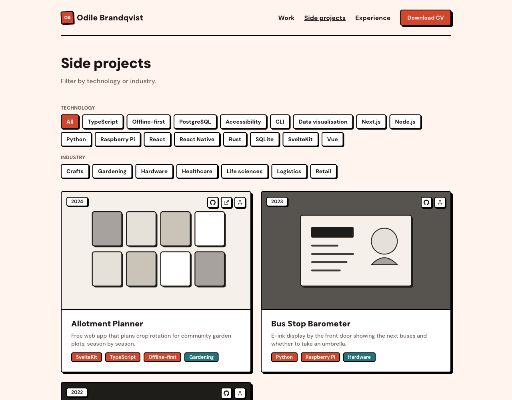</a><br>
<b>Side projects</b> (<code>/side-projects</code>): the same list with personal projects first, each with links to its code and live site.
</td>
</tr>
<tr>
<td valign="top" width="50%">
<a href="src/app/experience/page.tsx">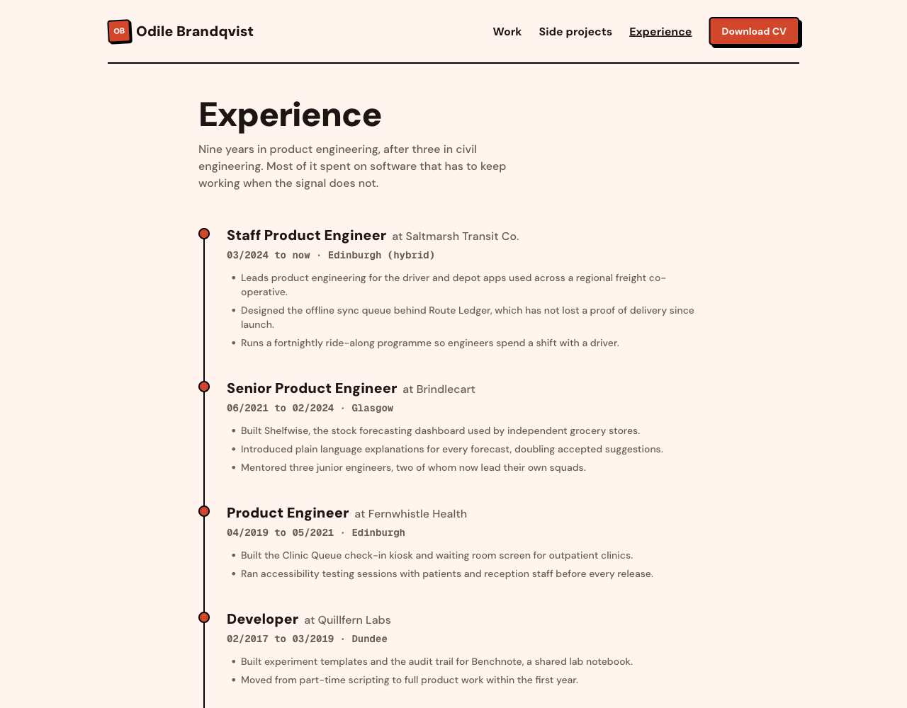</a><br>
<b>Experience</b> (<code>/experience</code>): a timeline of your roles with dates, places and highlights, from <code>content/experience.json</code> or <code>/admin</code>.
</td>
<td valign="top" width="50%">
<a href="content/faqs.json">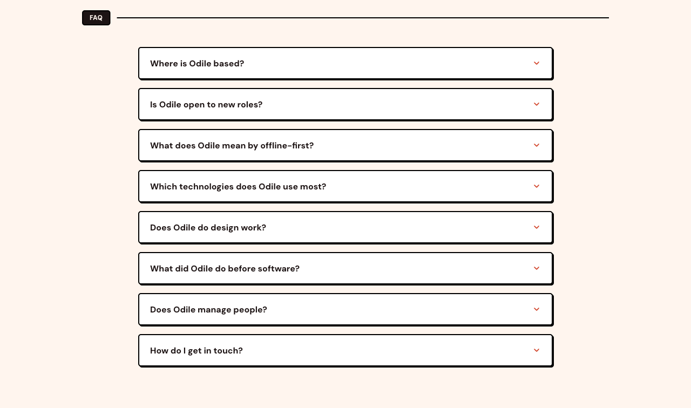</a><br>
<b>FAQ</b>: questions visitors ask most, as an accordion on the home page. They come from <code>content/faqs.json</code> or <code>/admin</code>.
</td>
</tr>
<tr>
<td valign="top" width="50%">
<a href="src/app/cv/route.ts">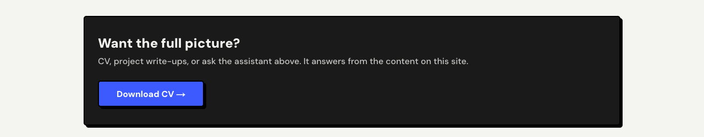</a><br>
<b>CV download</b>: buttons in the header and on the home page. <code>/cv</code> serves <code>public/cv.pdf</code> with a dated file name.
</td>
<td valign="top" width="50%">
<a href="src/app/admin">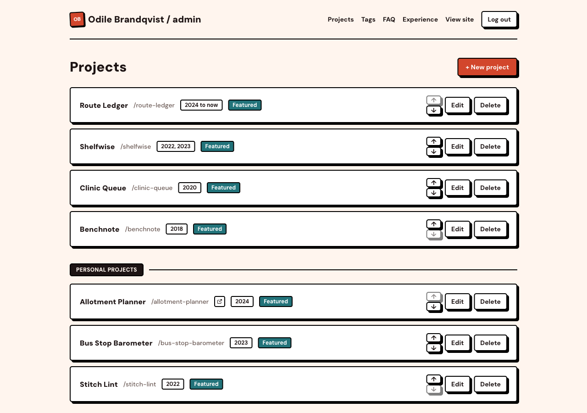</a><br>
<b>Admin panel</b> (<code>/admin</code>): a password protected editor for projects, tags, FAQs and experience. Add, edit, reorder and delete without touching code.
</td>
</tr>
</table>

Every page also has a phone layout, with a menu in place of the header links:

<p>
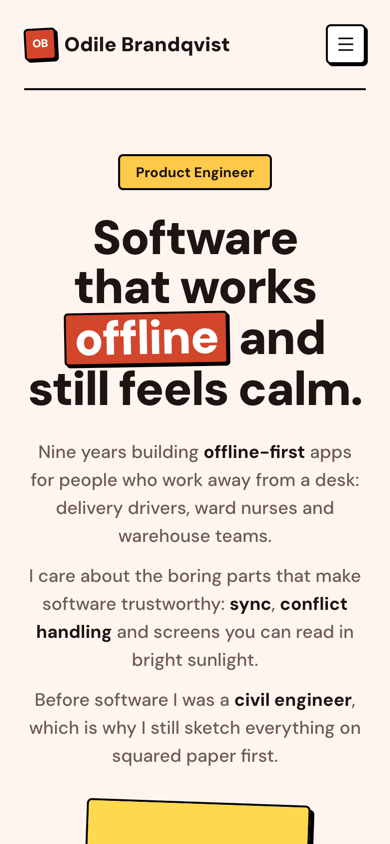
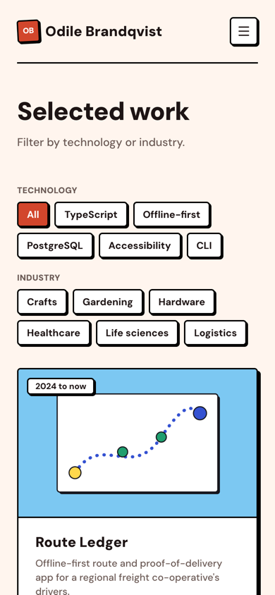
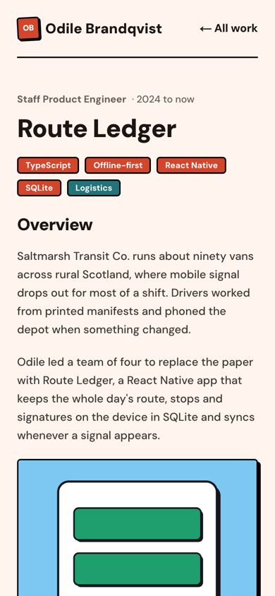
</p>

## How the portfolio works

| Part | Where it lives |
|---|---|
| Projects, experience, FAQs, tags | Postgres. Loaded from the JSON files in `content/` with `npm run db:seed`, or edited in `/admin`. |
| Name, hero text, stats, journey, colour theme, contact links | `site.config.ts`, one file for everything person-specific. |
| Images | `public/`, with project images in `public/projects/<slug>/`. |
| CV | `public/cv.pdf`. |

Pages render on request, so an edit in `/admin` or a content script shows up on the next page load, with no rebuild. Details are in [Make it yours](#make-it-yours).

## The AI layer (optional)

The AI layer is optional. Each part has its own [feature flag](#feature-flags); switch all three off and you have a plain portfolio.

On the home page, visitors and recruiters get one panel with three tabs:

<table>
<tr>
<td valign="top" width="50%">
<a href="src/components/chat-panel.tsx">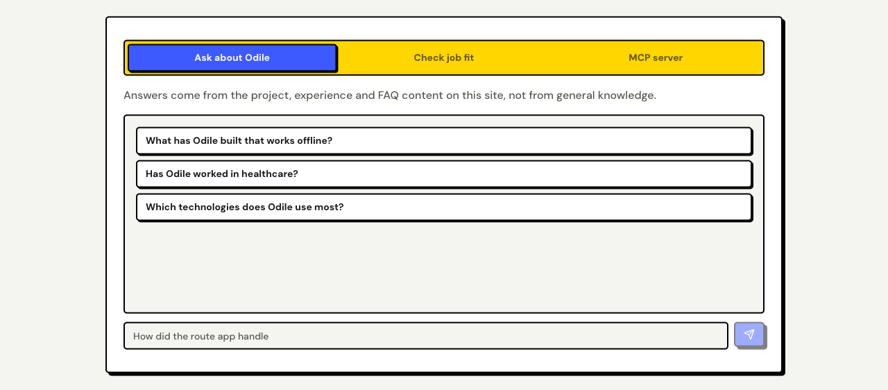</a><br>
<b>Chat</b>: visitors ask about your work and get answers taken only from your projects, experience and FAQs. Suggested questions come from <code>site.config.ts</code>.
</td>
<td valign="top" width="50%">
<a href="src/components/fit-check-panel.tsx">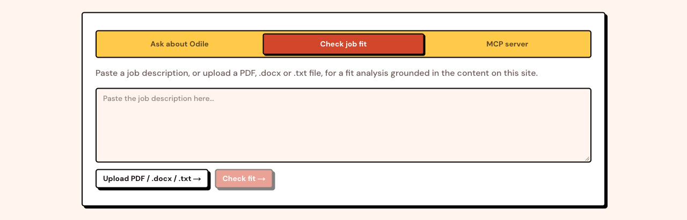</a><br>
<b>Fit check</b>: a recruiter pastes a job description (or uploads a PDF, .docx or .txt) and gets a verdict, strengths and gaps based on your content.
</td>
</tr>
<tr>
<td valign="top" width="50%">
<a href="src/components/mcp-panel.tsx">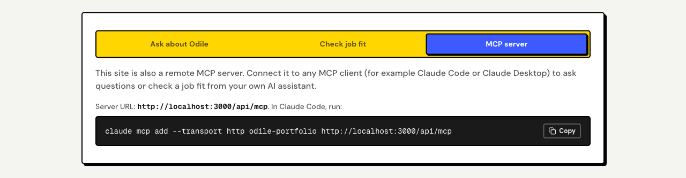</a><br>
<b>MCP server</b>: the site is also a remote MCP server, so an AI assistant such as Claude Code can ask about you, check a job fit and fetch your CV. See <a href="#mcp-usage">MCP usage</a>.
</td>
<td valign="top" width="50%">
</td>
</tr>
</table>

### How the AI layer works

The [animation above](#how-the-ai-layer-answers) shows these steps.

1. Your content (projects, experience, FAQs) lives in Postgres. You load it from the JSON files in `content/` or edit it in `/admin`.
2. `npm run rag:ingest` splits that content into short chunks, turns each into an embedding (a list of 1536 numbers that captures its meaning) with OpenAI, and stores them in a pgvector column.
3. When a visitor asks a question, the question is embedded the same way, the closest chunks are found by cosine distance, and only those chunks are given to the chat model as context.
4. The fit check does the same with a job description, and the model's JSON answer is validated before it is shown.
5. The MCP server wraps the same two functions as tools, so an AI assistant can query your portfolio directly.

Admin edits and the content scripts re-sync the index automatically. Only changed text is embedded again, so edits cost almost nothing.

## Deploy in one click

The [Deploy with Vercel](#ai-portfolio-starter) button at the top copies this repo to your GitHub account, creates a free Neon database for it, and asks for three values: your OpenAI API key, a password for `/admin`, and a long random string for `SESSION_SECRET` (`openssl rand -base64 32`). The first deploy then sets the database up by itself: it creates the tables, loads the sample content and builds the chat's search index (see [What happens on deploy](#what-happens-on-deploy)). You get a working site with the sample persona; then [make it yours](#make-it-yours) and follow the [cost steps](#cost-and-security) before you share the link.

## Quick start

You need Node.js 20 or newer and an OpenAI API key. Pick Neon (hosted) or Docker (local) for the database.

```bash
# Use "Use this template" on GitHub, or clone your fork:
git clone https://github.com/<your-username>/ai-portfolio-starter.git
cd ai-portfolio-starter
npm install
cp .env.example .env
```

### Option A: Neon (recommended, works with Vercel)

1. Create a free project at [neon.tech](https://neon.tech).
2. Copy its connection string into `DATABASE_URL` in `.env`. You do not need to enable anything by hand: the first migration creates the `vector` extension.

### Option B: Docker for local development

```bash
npm run db:up   # Postgres 17 with pgvector on localhost:5432
```

The default `DATABASE_URL` in `.env.example` already points at it. `npm run db:down` stops it.

### Then, for either option

1. Set `ADMIN_PASSWORD`, `SESSION_SECRET` (`openssl rand -base64 32`) and `OPENAI_API_KEY` in `.env`.
2. Create the tables, load the sample content and build the search index:

```bash
npm run db:migrate   # prisma migrate deploy
npm run db:seed      # loads content/ into the database
npm run rag:ingest   # embeds the content for the chat
npm run dev
```

Open http://localhost:3000.

### Deploy to Vercel by hand

1. Push your copy to GitHub and import it in Vercel.
2. Add the environment variables from `.env` (at least `DATABASE_URL`, `ADMIN_PASSWORD`, `SESSION_SECRET` and `OPENAI_API_KEY`). `NEXT_PUBLIC_SITE_URL` is only needed for a custom domain; otherwise the Vercel production URL is used.
3. Deploy. The first build prepares the database, as below.
4. Before you share the link, follow the cost steps in [Cost and security](#cost-and-security).

### What happens on deploy

Vercel runs `npm run vercel-build` (`scripts/vercel-build.ts`), which runs these steps before the normal build:

1. `prisma migrate deploy`: creates or updates the tables and the `vector` extension. It uses `DATABASE_URL_UNPOOLED` when set (the Neon integration sets it), because migrations need a direct connection.
2. Loads the sample content from `content/`, **only while the database has no projects**, so it never overwrites or brings back what you changed in `/admin`.
3. `rag:ingest`: embeds only new or changed text, so a redeploy with no content changes costs nothing. If `OPENAI_API_KEY` is missing or wrong, the build still succeeds and prints a warning; fix the key and redeploy.

Without `DATABASE_URL` the steps are skipped and only the site is built. `npm run build` never touches the database, so local builds work offline. If you use Vercel preview deployments with the same database as production, previews run the same migrations against it; Neon's integration can give each preview its own database branch instead.

## Environment variables

| Variable | Required | Purpose |
|---|---|---|
| `DATABASE_URL` | Yes | Postgres with pgvector. Neon URLs use Neon's serverless driver, others use node-postgres. `DATABASE_DRIVER=neon` or `pg` forces one. |
| `ADMIN_PASSWORD` | For admin | Password for `/admin`. Refused in production while it is still the example value. |
| `SESSION_SECRET` | For admin | Signs the admin cookie. Changing it logs every session out. |
| `OPENAI_API_KEY` | For AI features | Embeddings and answers. |
| `CHAT_MODEL` | No | Defaults to `gpt-4.1-mini`. |
| `EMBEDDING_MODEL` | No | Defaults to `text-embedding-3-small` (1536 dimensions). |
| `NEXT_PUBLIC_SITE_URL` | No | Public URL; overrides `url` in `site.config.ts`. |
| `FEATURE_*` | No | Feature flag overrides, see below. |
| `RATE_LIMIT_PER_MINUTE`, `RATE_LIMIT_PER_DAY` | No | Per-IP limits for the AI endpoints. |
| `GITHUB_TOKEN` | No | Used by the profile import for a higher GitHub rate limit. Without it, GitHub allows 60 requests an hour. |

**About the embedding dimension:** the `Chunk.embedding` column is `vector(1536)`, the output size of `text-embedding-3-small`. If you switch to a model with a different size, change `vector(1536)` in `prisma/schema.prisma`, create a new migration, and run `npm run rag:ingest -- --full`.

## Make it yours

1. **`site.config.ts`** holds everything person-specific: name, initials, role, contact, socials, hero text, stats, journey, colour theme (see [Colour themes](#colour-themes)), chat persona and suggestions, fit-check criteria, MCP server name, CV file name, admin label, SEO and feature flags. Start here.
2. **`content/`** holds the sample content. Replace `content/projects/*.json` (same shape as `scripts/example-project.json`), `content/experience.json` and `content/faqs.json`, then run `npm run db:seed` and `npm run rag:ingest`. The seed upserts by slug, so remove the sample projects in `/admin` or with `npm run project:delete -- <slug>`.
3. **Images** go in `public/`. Project images live in `public/projects/<slug>/`; their sizes are measured at install and build time so covers of the right shape fill their card. Replace `public/avatar.svg` with your photo (and update `person.photo`).
4. **CV:** replace `public/cv.pdf` with your own.
5. **`/admin`** lets you edit all content in the browser once deployed. Every save updates the chat's search index in the background.
6. **Projects from the command line or a coding agent:** `npm run project:upsert -- path/to/project.json` creates or updates one project from a JSON file (same shape as `scripts/example-project.json`), and `npm run project:delete -- <slug>` removes one. Both re-sync the chat's search index straight away, so an AI coding assistant can manage your projects for you.

### Import from LinkedIn, CV and GitHub

Instead of typing everything, give the import your LinkedIn profile URL, a CV file (PDF, .docx or .txt, up to 5 MB) and your GitHub username. Each one is optional. It drafts your name, role, location, links, home page text (badge, headline, intro, stats, journey), SEO text, experience, FAQs and projects, and shows you a summary before anything is written.

* **What is read.** LinkedIn: your public profile page. CV: the text of the file. GitHub: your public profile and up to six of your own repositories that are not forks or archived (most stars first, then the most recently updated), with their descriptions, topics, languages and READMEs. `GITHUB_TOKEN` is used when set, for a higher rate limit.
* **LinkedIn is best effort.** LinkedIn often blocks automated reads. The import tries once, with no login and no retries, and tells you when it could not read the page. Then open your profile on LinkedIn, choose More, then Save to PDF, and give that PDF as your CV file instead.
* **Nothing is made up.** The model is told to use only facts from your sources and to leave anything unknown empty. Links, your email address and stat numbers that do not appear in your sources are dropped, and the summary lists what was left out. Check the draft anyway.
* **Privacy.** Your CV and profile text are sent to OpenAI with your own key (or read by your own coding agent). Nothing is stored except what you approve.
* **Cost.** One model call per draft, a few cents at most with the default model.

Where to run it:

* `npm run setup` asks "Import from LinkedIn, CV and GitHub?" first. The draft becomes the default answer to each question, so you can still change any of them, and it writes `site.config.ts` and `content/`.
* On a deployed site, open `/admin/import`. It saves projects, experience and FAQs to the database, and gives you a `site.config.ts` snippet for your name and home page text to paste, commit and redeploy (a deployed site cannot change its own config). It uses the deployment's `OPENAI_API_KEY`.
* A coding agent can run `npm run import -- --linkedin <url> --cv <path> --github <user> --out draft.json`, show you the summary, and after your yes write it with `npm run import -- --apply draft.json`.

### Colour themes

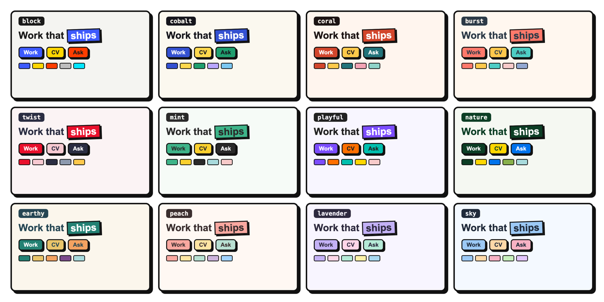

Pick a theme in `site.config.ts` with one line, for example `theme: themes.slate`. Coral is the default. The themes live in `themes.ts`. To change single colours, spread a theme and override what you need: `theme: { ...themes.coral, primary: "#b83a22" }`. Every button colour in the ready-made themes passes WCAG AA contrast (text stays readable on it). Links and highlighted words use a deeper shade of your primary colour, worked out at build time, so they stay readable even with light or pastel colours and your own custom values.

## Feature flags

Set in `site.config.ts` under `features`, or per deployment with environment variables (`true`/`false`), which win.

| Flag | Env var | Default | When off |
|---|---|---|---|
| `chat` | `FEATURE_CHAT` | on | Chat tab hidden, `/api/chat` returns 404, MCP chat tool removed |
| `fitCheck` | `FEATURE_FIT_CHECK` | on | Fit-check tab hidden, `/api/fit-check` returns 404, MCP tool removed |
| `parseJd` | `FEATURE_PARSE_JD` | on | File upload hidden, `/api/parse-jd` returns 404 (also off when `fitCheck` is off) |
| `mcp` | `FEATURE_MCP` | on | MCP tab hidden, `/api/mcp` returns 404 |
| `admin` | `FEATURE_ADMIN` | on | `/admin` returns 404 and every admin action refuses to run |
| `cv` | `FEATURE_CV` | on | CV buttons hidden, `/cv` returns 404 |
| `easterEggs` | `FEATURE_EASTER_EGGS` | off | Canned answers in `easterEggs` are ignored |
| `rateLimit` | `FEATURE_RATE_LIMIT` | on | No per-IP limits (not recommended in production) |

## Cost and security

The AI endpoints are public, so anyone can make the site spend your OpenAI credit. Each chat or fit-check call is one embedding plus one chat completion with roughly 1,500 to 3,000 input tokens: a fraction of a cent at current prices, so the risk is volume, not single calls. Before you share the link:

1. **Set a monthly budget** on the OpenAI project that owns your key (OpenAI dashboard, project limits). This is the hard stop.
2. **Add a Vercel Firewall rate limit rule** for `/api/*` (Vercel dashboard, Firewall). The built-in limiter works per server instance, so it slows a single client down but is not a global cap.
3. Use a long random `ADMIN_PASSWORD` and `SESSION_SECRET`.

What the code already does: every admin server action checks the session itself (not only the `/admin` proxy); login attempts are rate limited and only redirect inside `/admin`; AI inputs have length caps (2,000 characters for questions, 8,000 for job descriptions, 5 MB for uploads); the prompts treat visitor text as data and refuse off-topic requests; the fit-check JSON is validated with zod; embeds run in a sandboxed iframe with an optional host allowlist (`embeds.allowedHosts`). Sessions last 7 days and cannot be revoked one by one; rotate `SESSION_SECRET` to log everyone out.

The fit check is a guide, not proof: it only knows what is on your site, and the page says so.

See [SECURITY.md](SECURITY.md) to report a vulnerability.

## MCP usage

With `mcp` on, your deployed site is a remote MCP server (Streamable HTTP) at `https://your-domain/api/mcp` with these tools:

| Tool | Input |
|---|---|
| `ask_about_<firstName>` | `question` (up to 2,000 characters) |
| `check_job_fit` | `jobDescription` (20 to 8,000 characters) |
| `get_cv` | none, returns the `/cv` link |

Connect it from Claude Code:

```bash
claude mcp add --transport http your-portfolio https://your-domain/api/mcp
```

Other MCP clients that support remote HTTP servers take the same URL. MCP calls share the per-IP rate limits of the site.

## Project structure

```
site.config.ts        everything person-specific, plus feature flags
content/              sample projects, experience and FAQs (JSON)
prisma/               schema, single init migration, seed (loads content/)
scripts/              setup, profile import, ingest, project upsert and delete, cover measuring
src/app/              pages, admin, API routes (chat, fit-check, parse-jd, mcp), /cv
src/components/       UI, including shadcn/ui primitives in ui/
src/lib/              config, RAG, index sync, auth, rate limiting, content blocks, profile import
public/               avatar, sample CV, project images, embed video player
docker-compose.yml    local Postgres with pgvector
```

## Tips

* Prisma publishes agent skills for working with Prisma; install them with your agent's skills tooling if you use an AI coding assistant.
* `npm run rag:ingest -- --full` re-embeds everything (after a model change).
* Content written by scripts appears immediately, because content pages render on request.

## Credits

* [shadcn/ui](https://ui.shadcn.com) for the UI primitives in `src/components/ui/` (MIT).
* [neobrutalism.dev](https://www.neobrutalism.dev) ([neobrutalism-components](https://github.com/ekmas/neobrutalism-components), MIT, by Samuel Breznjak) for the neo-brutalist border, shadow and radius structure.
* Several themes are adapted from the [neobrutalism palettes collected on colorany.com](https://colorany.com/color-palettes/neobrutalism-color-palettes/).
* [Simple Icons](https://simpleicons.org) for the GitHub mark (CC0).
* DM Sans and Geist Mono fonts (SIL Open Font License), via `next/font`.
* Built on Next.js, React, Prisma, pgvector, Tailwind CSS, OpenAI, mcp-handler, unpdf and mammoth.

## Licence

Code: [MIT](LICENSE). Sample content (everything in `content/`, the sample CV, avatar and project images in `public/`) is released under [CC0](https://creativecommons.org/publicdomain/zero/1.0/): use it freely while you test. The sample persona and every company and project in it are fictional; any resemblance to real people or businesses is a coincidence.

## About

[](https://www.mehmetmutlu.dev)

Made by Mehmet Mutlu, [mehmetmutlu.dev](https://www.mehmetmutlu.dev). If it helps you, you can support it on [GitHub Sponsors](https://github.com/sponsors/mutlumehmet) or [Buy Me a Coffee](https://buymeacoffee.com/mutlumehmet).
